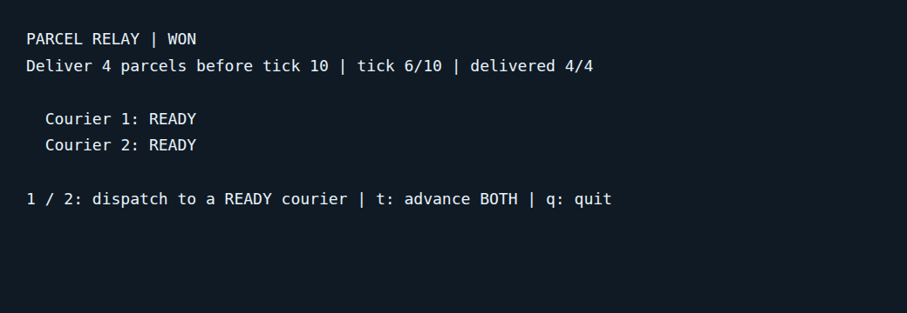

# Parcel Relay

Dispatch parcels to two supervised courier processes. Deliver **four parcels by tick ten**.

- **1 / 2** sends an idle courier by the safe route (3 ticks).
- **1s / 2s** uses the shortcut (2 ticks). The bridge closes at ticks **4 and 8**: a shortcut parcel still in transit is lost and its courier process restarts READY.
- **t** advances both couriers together. A busy courier keeps its parcel and route. Invalid commands cost no time. **q** or EOF exits.

The screen shows closures before you choose. Avoid dispatching a shortcut across a closure; the safe route remains available. Each courier is a supervised GenServer. The restart budget covers both couriers at both scheduled closures. There is no background clock or network service.



Captured from the real CLI demo on 2026-11-06; its stdout is rendered in a monospace viewer for the image. The game runs in a terminal.

## Install and play

Linux x86-64, no sudo or containers. Install the current stable runtime as checked on 2026-11-06 ([Elixir installation](https://elixir-lang.org/install/)).

```sh
curl -fsSLo install.sh https://elixir-lang.org/install.sh
sh install.sh elixir@1.20.5 otp@29.1
export PATH="$HOME/.elixir-install/installs/otp/29.1/bin:$HOME/.elixir-install/installs/elixir/1.20.5-otp-29/bin:$PATH"
mix local.hex --force
MIX_ENV=test mix deps.get
```

Python 3.14 is required by the local report adapter. From this repository:

```sh
make play
make demo
make test
make check
```

`test` runs native unit tests; `check` also drives a real CLI victory. JUnit XML and schema-versioned summary JSON go to ignored `test-results/`. No test contacts a live service. PR CI runs unit checks only.

M2 is implemented; M3 remains a separate milestone. Terminal accessibility, Windows and macOS execution, long sessions and player enjoyment are unverified.

Verified on Linux: 10 ExUnit cases + 1 CLI smoke, all passing. See [requirements](docs/requirements.md).
