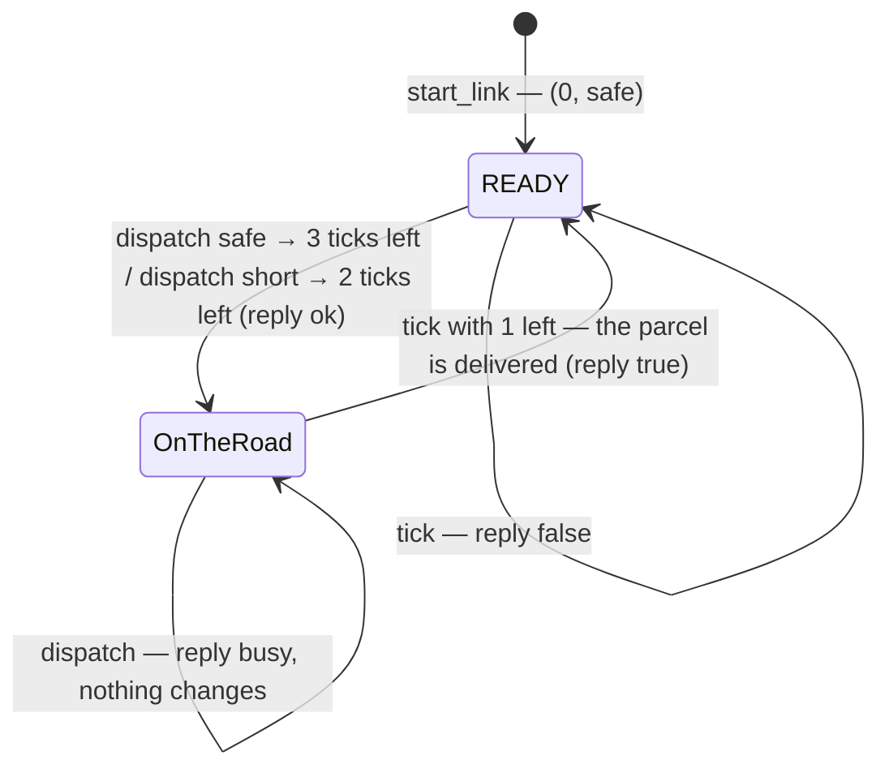
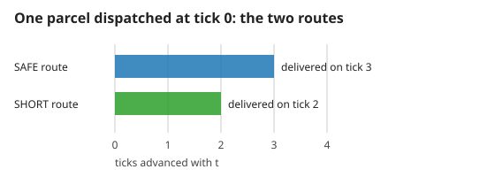
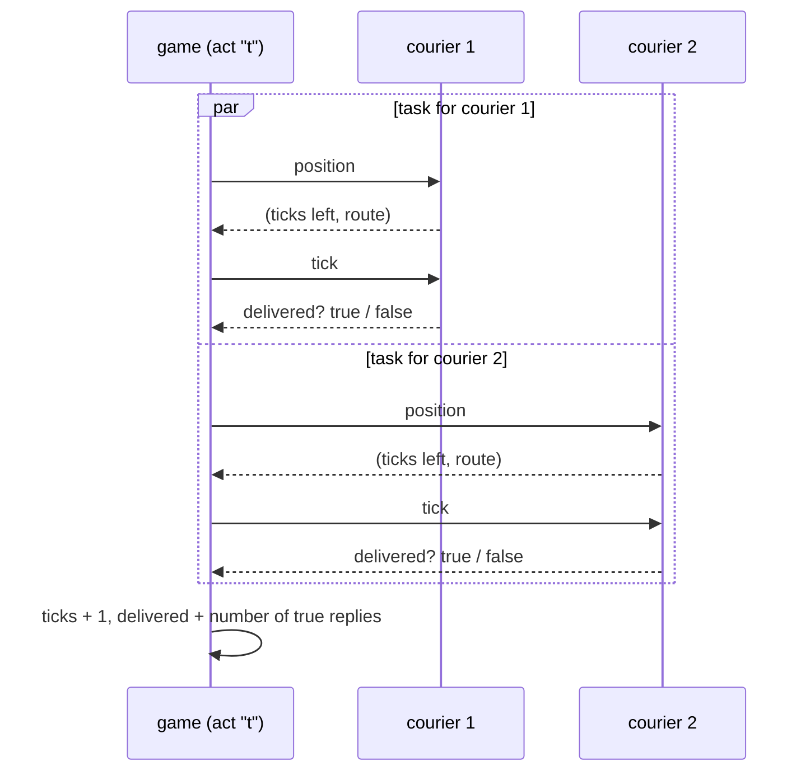
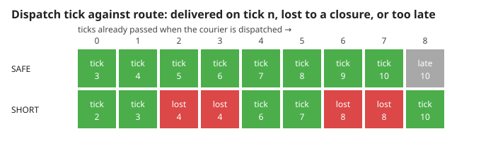

# 1. Couriers, routes and the bridge

Two couriers, each a real process, carry parcels on a safe or a short route while a bridge closes on schedule. Measured numbers are quoted by their id in [figures/values.md](figures/values.md).

[Back to the index](README.md)

## S01 — A courier is a process with two numbers

**Statement.** Each courier is one process whose whole state is the pair

$$(\text{ticks left},\ \text{route}), \qquad \text{ticks left} \in \{0, 1, 2, 3\},\quad \text{route} \in \{\text{safe}, \text{short}\} .$$

A courier with 0 ticks left is **READY**. It answers three messages and nothing else: *dispatch* (take a parcel), *tick* (move one step) and *position* (report the pair).

**Assumptions and where they break.** The state lives only in the process: when the process dies, the pair — and the parcel it stands for — is gone (S04). Messages to one courier are handled one at a time, in order.

**Derivation.** A design rule; the process is a generic server [Armstrong 2003, ch. 4] whose callbacks are the three messages.

**Code.** `ParcelRelay.Courier` in `lib/parcel_relay.ex`: `start_link`, `init` and the five clauses of `handle_call`.

**Tests.** `REQ-dispatch busy courier cannot lose its current parcel` in `test/parcel_relay_test.exs`. Measured: `busy-refused` = 1 and `busy-keeps-route` = 2 ticks still left on the first parcel.

## S02 — Safe takes three ticks, short takes two

**Statement.** A parcel dispatched on the safe route is delivered on the third tick after dispatch; on the short route, on the second. A courier carries one parcel at a time: dispatching to a courier on the road is refused with *busy* and changes neither its parcel nor its route.

**Assumptions and where they break.** Dispatching costs no tick. Only the command `t` moves time (S03).

**Derivation.** Dispatch sets the ticks left to 3 or 2; each tick lowers it by one; the tick that finds 1 left reports the delivery.

**Code.** The two `{:dispatch, route}` clauses and the `:tick` clause of `handle_call` in `lib/parcel_relay.ex`; the commands `1`, `2`, `1s`, `2s` in `apply_command`, reached through `act`.

**Tests.** `REQ-route shortcut saves one tick before the outage`, `REQ-route safe parcels survive the bridge closure; busy dispatch preserves route`. Measured: `route-safe` = 3, `route-short` = 2.

## S03 — One tick moves both couriers, concurrently

**Statement.** The command `t` advances the tick counter by one and sends *tick* to both couriers at the same time, in two tasks; the game then counts how many of them reported a delivery. The result does not depend on which task ran first.

**Assumptions and where they break.** The two couriers share nothing, so their order cannot matter. Anything shared between them (a common stock of parcels, say) would break this argument.

**Derivation.** Each task talks to one courier only, and each courier's reply depends only on its own state (S01). Two computations on disjoint state commute, so the pair of replies is the same in either order; the game combines them with a count, which ignores order as well.

**Code.** `apply_command(game, "t")` and `advance` in `lib/parcel_relay.ex` (`Task.async_stream` with two workers); `worker` finds a courier's current process.

**Tests.** `REQ-dispatch both couriers really advance on the same tick`. Measured: `tick-both` = 2 couriers moved by one `t`.

## S04 — The bridge closes on ticks 4 and 8

**Statement.** On tick 4 and on tick 8, every courier that is on the road on the **short** route is stopped: its process is killed and its parcel is lost. Safe parcels are never affected. A short parcel dispatched after $d$ ticks is on the road during ticks $d+1$ and $d+2$, so it is lost exactly when

$$d + 1 \in \{4, 8\} \quad\text{or}\quad d + 2 \in \{4, 8\}, \qquad\text{that is}\quad d \in \{2, 3, 6, 7\} .$$

**Assumptions and where they break.** The closure is checked before the tick is applied: a short parcel that would arrive on tick 4 is lost, not delivered.

**Derivation.** From S02 a short parcel has 2 ticks left after dispatch and 1 left one tick later; both are "on the road". The closure hits whichever of those two ticks is 4 or 8.

**Code.** `advance` in `lib/parcel_relay.ex` (the clause `{left, :short} when left > 0 and tick in @closure_ticks`) and the list `@closure_ticks`.

**Tests.** `REQ-recovery outage restarts both actual processes without reviving parcels`, `REQ-route safe parcels survive the bridge closure; busy dispatch preserves route`. Measured through the real game: `closure-short-lost` = 4 of the nine dispatch ticks, the earliest being `closure-first-lost` = 2; `closure-safe-lost` = 0.

## References

- J. Armstrong, *Making reliable distributed systems in the presence of software errors*, PhD thesis, Royal Institute of Technology, Stockholm, 2003 — processes, generic servers and supervision.
