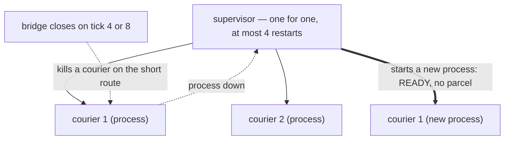
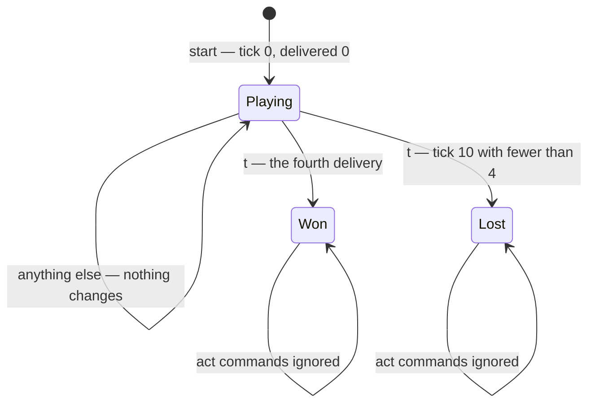
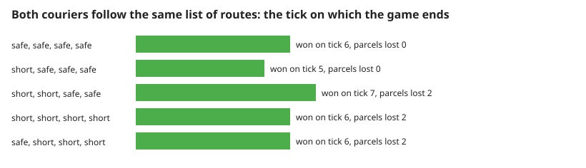
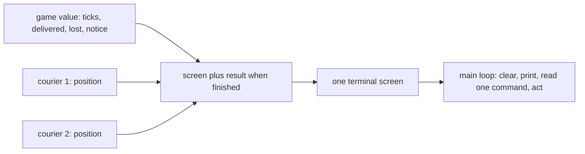

# 2. Supervision, the end of the game and the best plan

What happens to a stopped courier, how a game ends, and which plan wins soonest. Measured numbers are quoted by their id in [figures/values.md](figures/values.md).

[Back to the index](README.md)

## S05 — A stopped courier is replaced, empty-handed

**Statement.** The two couriers run under a supervisor with the *one for one* strategy: when one courier's process dies, the supervisor starts a new process for that courier alone, and the other is untouched. The new courier is READY with no parcel; the lost parcel does not come back. The supervisor tolerates

$$\text{max restarts} = (\text{number of couriers}) \times (\text{number of closures}) = 2 \times 2 = 4$$

restarts, which is the most a game can cause, so the supervisor itself never gives up.

**Assumptions and where they break.** A game lasts well under the supervisor's counting window, so all four restarts can fall inside it; with the default limit of three, the fourth would bring the supervisor — and the game — down.

**Derivation.** A new process starts from the initial state of S01, which is READY. Each closure can stop each courier at most once, hence at most $2 \times 2$ restarts; the limit is computed from those two numbers rather than written as a constant [Armstrong 2003, ch. 5].

**Code.** `start` (the supervisor, its strategy and `max_restarts`), `advance` (the kill, the wait for the process to go down) and `await_restart` in `lib/parcel_relay.ex`; `worker` looks the new process up by the courier's number.

**Tests.** `REQ-recovery outage restarts both actual processes without reviving parcels`, `REQ-recovery both closures can replace both workers in one fast game`. Measured: after one closure stops both couriers, `restart-new-pids` = 2 process identifiers changed, `restart-alive` = 2 and `restart-ready` = 2; when both closures stop both couriers, `restart-four` = 4 parcels are lost and `restart-supervisor` = 1 (still alive).

## S06 — Four deliveries by tick ten

**Statement.** The game is **won** as soon as 4 parcels have been delivered and **lost** when tick 10 is reached with fewer. A delivery on tick 10 itself counts. The `act` function ignores further commands on a finished game value; the CLI handles r/n/q separately (S11). While playing, a command that is not one of `1`, `2`, `1s`, `2s`, `t` changes nothing and costs no tick.

**Assumptions and where they break.** Winning is checked before losing, so four deliveries on tick 10 is a win.

**Derivation.** A design rule.

**Code.** `status` and `act` in `lib/parcel_relay.ex`; `screen` shows the status line; `main` runs the loop and stops the supervisor on exit.

**Tests.** `REQ-finish four deliveries win and finished games freeze`, `REQ-finish last tick still permits a delivery`, `REQ-finish route choices and tick ten have deterministic results`, `REQ-input invalid commands preserve time`. Measured: two safe rounds win on `win-safe-tick` = 6; three more commands leave `frozen-ticks` = 6 and `frozen-delivered` = 4; a game with no dispatch is lost on `idle-lost-tick` = 10; five invalid commands use `invalid-ticks` = 0.

## S07 — The soonest win is tick 5: short first, then safe

**Statement.** When both couriers follow the same list of routes, dispatching as soon as they are READY, the earliest possible win is **tick 5**, reached by starting short and continuing safe. All-safe wins on tick 6. All-short also ends on tick 6, but loses two parcels to the tick-4 closure on the way.

**Assumptions and where they break.** This is the default seed 59. The search covers the sixteen lists of four routes with both couriers on the same list and no waiting; a player may also wait or give the couriers different routes, which is not searched here.

**Derivation.** By S04 a short parcel dispatched at tick 0 arrives on tick 2, but one dispatched at tick 2 is lost on tick 4. So the second parcel of each courier should be safe: dispatched at tick 2, delivered on tick 5 (S02). Two couriers deliver 2 parcels on tick 2 and 2 more on tick 5. The all-safe plan needs two rounds of three ticks. The table of all sixteen lists is produced by playing each through the real game.

**Code.** There is no solver in the game; the numbers come from `start`, `act` and `status` in `lib/parcel_relay.ex`, driven by `scripts/theory_figs.exs`.

**Tests.** `REQ-route shortcut saves one tick before the outage`, `REQ-finish route choices and tick ten have deterministic results`. Measured: `plans-tried` = 16, of which `plans-won` = 16 win by tick 10; the earliest is `plans-best-tick` = 5, reached by `plans-best-count` = 4 lists (all start short, safe); `plans-all-safe` = 6; all-short ends on `plans-all-short-tick` = 6 with `plans-all-short-lost` = 2 parcels lost.

## S08 — The screen is drawn from the processes

**Statement.** Every line of the screen is computed from the game value and from asking each courier for its position at that moment: the status, the tick and delivery counters, one lane per courier (READY, or route and ticks left), and the last notice. Nothing on the screen is stored separately.

**Assumptions and where they break.** The screen is read between commands, when no tick is in flight, so the positions it shows are consistent with the counters.

**Derivation.** A design rule: a display that asks the processes cannot disagree with them.

**Code.** `screen`, `main` and `loop` in `lib/parcel_relay.ex`.

**Tests.** `REQ-finish four deliveries win and finished games freeze` checks the status shown; `make check` plays a real game through the command line to WON.

## References

- J. Armstrong, *Making reliable distributed systems in the presence of software errors*, PhD thesis, Royal Institute of Technology, Stockholm, 2003 — supervision trees and restart limits.
