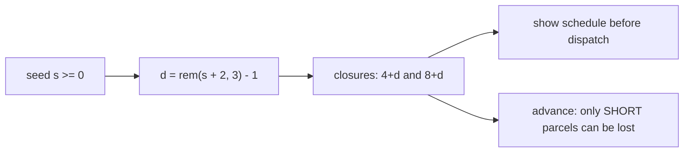
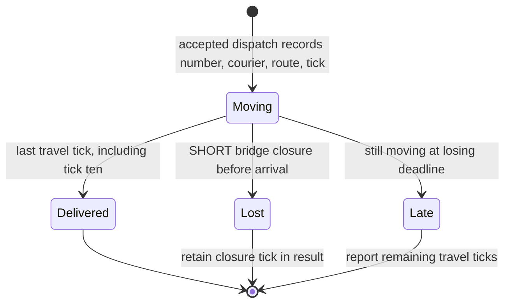
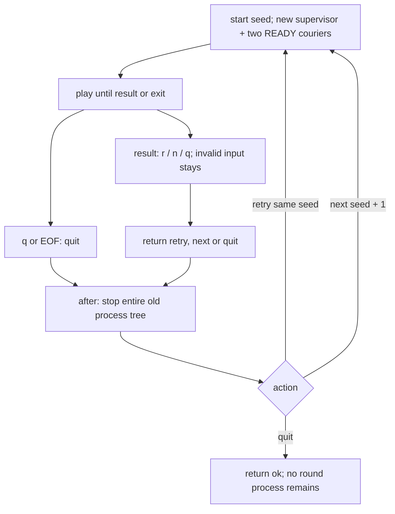

# 3. Seeds, results and round ownership

[Back to the index](README.md). The courier rules and the measurements in pages 1–2 use the default seed, 59.

## S09 — A seed selects a published bridge schedule

**Statement.** For a nonnegative integer seed s, the closure ticks are (4 + d, 8 + d), with d = rem(s + 2, 3) − 1. Thus seeds 59, 60 and 61 select (4, 8), (5, 9) and (3, 7). Both couriers share the same schedule, displayed before dispatch. Routes still take three or two ticks.

**Assumptions and where they break.** The seed selects one of three fixed schedules; it is not a random generator or a promise of a distinct level for every integer. The default seed preserves the earlier game and all its generated figures. Other seeds can have a different best route plan.

**Derivation.** A design rule. Remainders 0, 1 and 2 produce offsets −1, 0 and 1. Adding three to the seed repeats the schedule; adding one moves to the next schedule. Safe routes ignore every closure and win after two rounds, on tick six.

**Code.** `start` derives `closures` from the seed. `advance` uses that game's schedule, and `screen` displays it. `main` starts at seed 59 unless a seed is supplied.

**Tests.** `REQ-seed three closure schedules are reproducible and safe routes always win` checks all three schedules across nine seeds, including zero. The original route and restart tests and `make theory-figs` continue to use seed 59.

## S10 — Results explain parcels, not an invented score

**Statement.** Each accepted dispatch adds one parcel to the round's ledger, with a sequential number, courier, route and dispatch tick. A busy refusal adds none. Tick outcomes complete only that courier's moving parcel, once. Delivered and lost counts accumulate; late means parcels still moving when the game is lost on tick ten. The goal shortfall is max(0, 4 − delivered), a separate measure that also covers parcels never dispatched. Every loss names the shortcut bridge closure and its tick. Every late parcel names the deadline, route, dispatch tick and remaining travel time.

**Assumptions and where they break.** The single CLI owns dispatch and tick commands. These counters measure parcels, not people, elapsed real seconds or an economic score. A win can leave another parcel moving; it is not counted late. Losing a parcel does not itself end the round: the player may replace it before the deadline.

**Derivation.** At most one parcel per courier is moving (S02). A completed event therefore identifies that courier's moving ledger entry unambiguously. For a late entry, remaining ticks = dispatch tick + route duration − 10, which is positive because a delivery on tick ten is processed before the loss check. A lost entry keeps its closure tick even after later deliveries or invalid commands. Delivered, lost and moving entries partition all accepted dispatches; the shortfall is not their sum.

**Code.** `apply_command` records accepted dispatches and completes ledger entries after both tick tasks finish. `result` derives the breakdown and failure reasons; `result_screen` renders them without changing the game or restarting workers.

**Tests.** `REQ-result records each bridge failure once and preserves it after delivery` checks two couriers at both closures, a busy refusal, recovery deliveries, frozen final state and a result within 80 columns and 24 rows. `REQ-result late means dispatched but still travelling at the deadline`, `REQ-result no dispatch is a shortfall without invented lost or late parcels` and `REQ-result delivery on tick ten counts toward the victory` cover the boundary cases. `make check` repeats losses and deadline results through the real CLI.

## S11 — Each round owns its whole process tree

**Statement.** At a result, r begins a fresh round with the same seed, n begins a fresh round with seed + 1, and q exits. During play only q exits; r and n are ignored. EOF exits during play or at a result. The old supervisor is synchronously stopped, together with all of its couriers, before another round starts. Every new round has empty parcels, zero counters, READY couriers and a fresh restart budget. Invalid result input leaves the result unchanged.

**Assumptions and where they break.** Process ownership is local to one invocation of `main`; multiple separate games may coexist. Normal return and exceptions run cleanup through `try/after`. An external untrappable kill of the VM is outside this API contract. The UI waits for input after either result, so piped input must include q or end at EOF.

**Derivation.** `loop` returns an action rather than recursively starting a second supervisor. The `after` clause calls `stop` first; only then does `session` recurse with the chosen seed. This prevents both old game values and restart intensity from carrying over. The supervisor's synchronous stop waits for its linked children to terminate. See the official [Supervisor reference](https://elixir.hexdocs.pm/1.20.4/Supervisor.html#stop/3) and [GenServer reference](https://elixir.hexdocs.pm/1.20.4/GenServer.html).

**Code.** `main`, `session`, `loop` and `stop` in `lib/parcel_relay.ex`. `session` is responsible for lifetime; `act` still freezes a finished game value.

**Tests.** `REQ-session retry resets all state, next changes seed, quit removes every process` traces every descendant created by the CLI session and checks that they are dead after return. It also compares complete repeated initial and result screens. `REQ-session invalid result input costs nothing and EOF quits` covers EOF at a result. `scripts/cli_smoke.py` drives victory, repeated failure/retry/next, lateness, q during play, and EOF during play and at a result; each run must leave no live member of its OS process group. The CLI smoke is local only.
