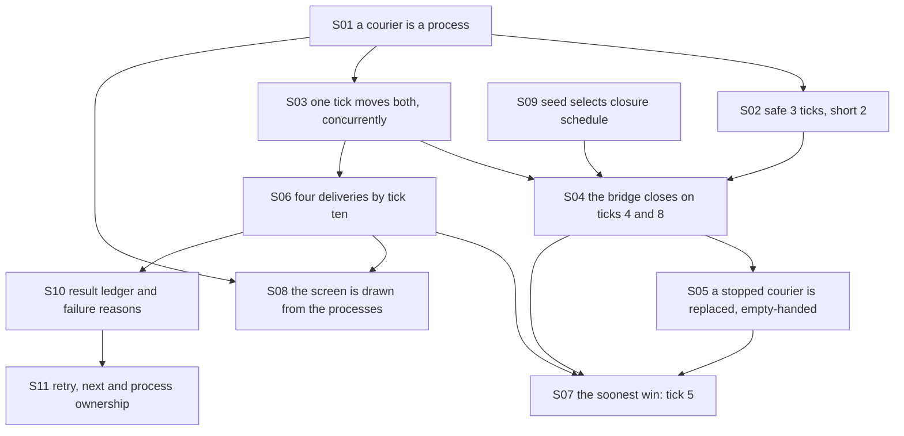

# Theory handbook

Why the program is correct, from the repository alone: every rule the code relies on, each stated in Markdown **with a figure**, the place in the code that implements it, and the test or measurement that checks it.

- Drawn figures and the numbers quoted in the text are produced by playing the real game with its supervised processes: `make theory-figs` rewrites [figures/](figures/) and [figures/values.md](figures/values.md). Other diagrams are Mermaid, written in the pages.
- `make theory-check` fails when a statement has no figure, a link is broken, a referenced function, test or measured value no longer exists, or a public function is missing from the table below.

## Pages

1. [Couriers, routes and the bridge](01-couriers-and-routes.md) — a courier as a process, the two routes, the concurrent tick, the scheduled closures
2. [Supervision, the end of the game and the best plan](02-supervision-and-the-game.md) — restart after a closure, winning and losing, the soonest win, the screen

3. [Seeds, results and round ownership](03-results-and-rounds.md) — deterministic schedules, parcel accounting, retry and cleanup

## How the pieces depend on each other

## Coverage: statement → page → figure → code → test

| ID | Statement | Page | Figure | Code | Test |
|---|---|---|---|---|---|
| S01 | A courier is a process holding (ticks left, route) | [1](01-couriers-and-routes.md) | mermaid | `lib/parcel_relay.ex#start_link`, `lib/parcel_relay.ex#init`, `lib/parcel_relay.ex#handle_call` | `test/parcel_relay_test.exs#REQ-dispatch busy courier cannot lose its current parcel` |
| S02 | Safe takes three ticks, short two; one parcel at a time | [1](01-couriers-and-routes.md) | `figures/routes.svg` | `lib/parcel_relay.ex#{:dispatch, route}`, `lib/parcel_relay.ex#act` | `test/parcel_relay_test.exs#REQ-route shortcut saves one tick before the outage`, `scripts/theory_figs.exs#route-short` |
| S03 | One tick moves both couriers concurrently | [1](01-couriers-and-routes.md) | mermaid | `lib/parcel_relay.ex#Task.async_stream`, `lib/parcel_relay.ex#worker` | `test/parcel_relay_test.exs#REQ-dispatch both couriers really advance on the same tick` |
| S04 | With seed 59 the bridge closes on ticks 4 and 8: short parcels on the road are lost | [1](01-couriers-and-routes.md) | `figures/closures.svg` | `lib/parcel_relay.ex#@closure_ticks`, `lib/parcel_relay.ex#defp advance` | `test/parcel_relay_test.exs#REQ-route safe parcels survive the bridge closure; busy dispatch preserves route`, `scripts/theory_figs.exs#closure-short-lost` |
| S05 | A stopped courier is restarted READY; at most four restarts | [2](02-supervision-and-the-game.md) | mermaid | `lib/parcel_relay.ex#start`, `lib/parcel_relay.ex#max_restarts`, `lib/parcel_relay.ex#await_restart` | `test/parcel_relay_test.exs#REQ-recovery outage restarts both actual processes without reviving parcels`, `test/parcel_relay_test.exs#REQ-recovery both closures can replace both workers in one fast game` |
| S06 | Four deliveries by tick ten; finished games freeze; invalid input is free | [2](02-supervision-and-the-game.md) | mermaid | `lib/parcel_relay.ex#status`, `lib/parcel_relay.ex#act` | `test/parcel_relay_test.exs#REQ-finish four deliveries win and finished games freeze`, `test/parcel_relay_test.exs#REQ-input invalid commands preserve time` |
| S07 | With seed 59 the soonest win is tick 5: short first, then safe | [2](02-supervision-and-the-game.md) | `figures/plans.svg` | `lib/parcel_relay.ex#apply_command` | `test/parcel_relay_test.exs#REQ-finish route choices and tick ten have deterministic results`, `scripts/theory_figs.exs#plans-best-tick` |
| S08 | The screen is drawn from the processes | [2](02-supervision-and-the-game.md) | mermaid | `lib/parcel_relay.ex#screen`, `lib/parcel_relay.ex#main` | `test/parcel_relay_test.exs#REQ-finish four deliveries win and finished games freeze` |
| S09 | Seed selects one of three bridge schedules | [3](03-results-and-rounds.md) | mermaid | `lib/parcel_relay.ex#start` | `test/results_test.exs#REQ-seed three closure schedules are reproducible and safe routes always win` |
| S10 | Accepted parcels explain delivered, lost, late and goal shortfall | [3](03-results-and-rounds.md) | mermaid | `lib/parcel_relay.ex#result`, `lib/parcel_relay.ex#result_screen` | `test/results_test.exs#REQ-result records each bridge failure once and preserves it after delivery`, `test/results_test.exs#REQ-result late means dispatched but still travelling at the deadline` |
| S11 | Each retry starts after its predecessor's whole process tree stops | [3](03-results-and-rounds.md) | mermaid | `lib/parcel_relay.ex#stop`, `lib/parcel_relay.ex#session`, `lib/parcel_relay.ex#loop` | `test/results_test.exs#REQ-session retry resets all state, next changes seed, quit removes every process`, `scripts/cli_smoke.py#group_alive` |

Tests named `scripts/theory_figs.exs#…` are measurements recorded in [figures/values.md](figures/values.md) by `make theory-figs`, not assertions of `make test`.

## Reading the source against this table

Functions reviewed for this handbook: all of `lib/parcel_relay.ex` — the courier's `start_link`, `init` and `handle_call`, and the game's `start`, `worker`, `status`, `act`, `screen`, `main` and `result`/`stop`, with the private `apply_command`, `advance`, `await_restart`, `result_screen`, `session` and `loop`.

Statements S01–S08 describe the seed-59 courier rules. M3 adds S09–S11 for seeds, result accounting and round lifetime; the original generated figures remain unchanged.
